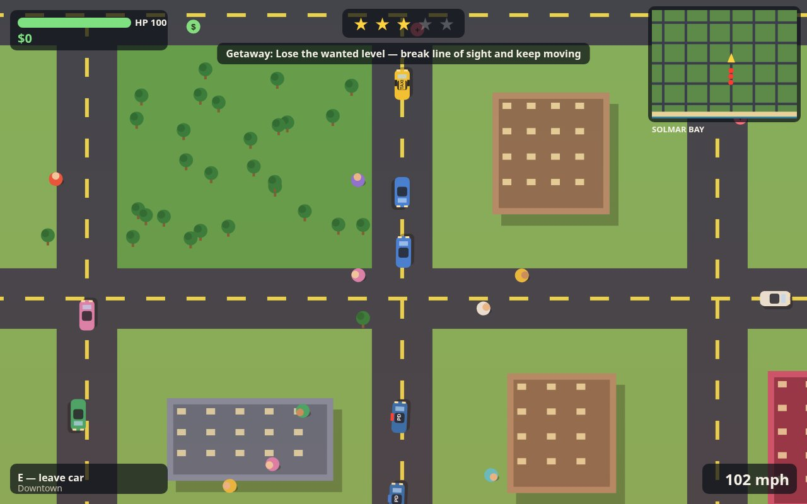
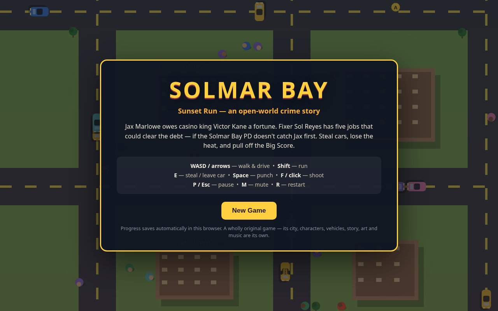
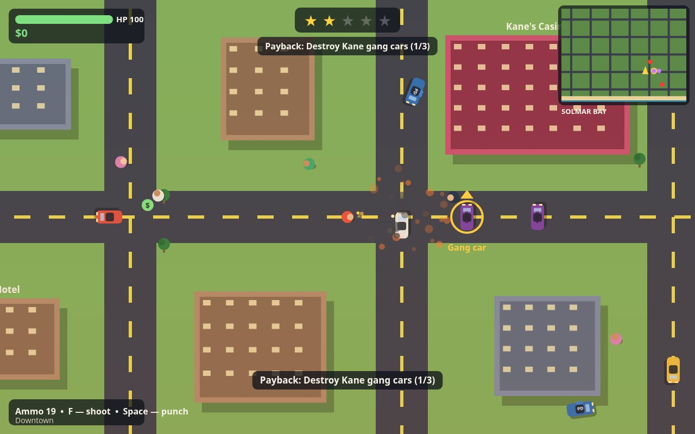
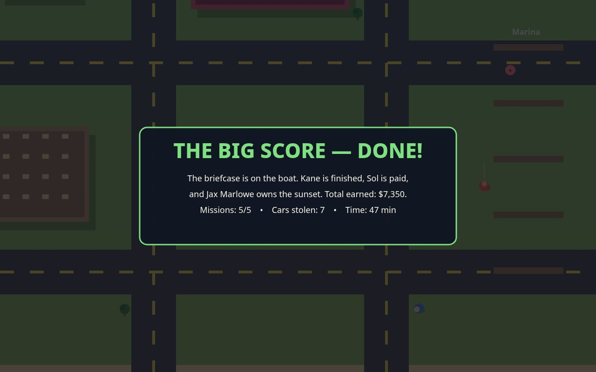

# Solmar Bay — Sunset Run

[](https://make.fun/bounty/gta6-01)

Solmar Bay is an open-world crime game built for make.fun's
[Make GTA 6](https://make.fun/bounty/gta6-01) bounty. Jax Marlowe owes casino
king Victor Kane a fortune; fixer Sol Reyes has five jobs that could clear the
debt — if the Solmar Bay PD doesn't catch Jax first.

Explore a sun-soaked coastal city on foot and by car: steal cars, outrun the
police, lose a wanted level, settle scores with Kane's gang, and pull off the
Big Score. All running offline from static files, no network requests.

## Play

Serve `game/` with any static HTTP server and open `game/index.html` in
desktop Chrome:

```sh
npx serve game
```

or run the bundled entry program, which hands the game in:

```sh
mkdir -p out && MAKEFUN_OUTPUT_DIR=out node main.ts
```

## How it plays

- **On foot:** WASD/arrows to walk, Shift to run, Space to punch, F or click
  to shoot, E to steal the nearest car.
- **Driving:** W/S accelerate and brake, A/D steer. Cars drift, crash, smoke
  and blow up; traffic and pedestrians share the roads.
- **Wanted level:** stealing, hitting pedestrians and shooting raise the heat
  (0–5 stars). Police cars chase and ram; foot cops try to hold you — get
  caught and you're BUSTED. Break line of sight to cool off.
- **Missions:** five story jobs from Sol Reyes, each with an objective marker
  on the HUD and minimap, paying out on completion. Finish all five to win.
- **Save:** progress (cash, missions, stats) saves automatically in the
  browser; Continue picks up where you left off.
- Pause (P/Esc), mute (M), restart (R).

## Screenshots






## License

MIT — see [LICENSE](LICENSE). A wholly original game: its city, characters,
vehicles, story, art and music are its own, nothing from any commercial game.
